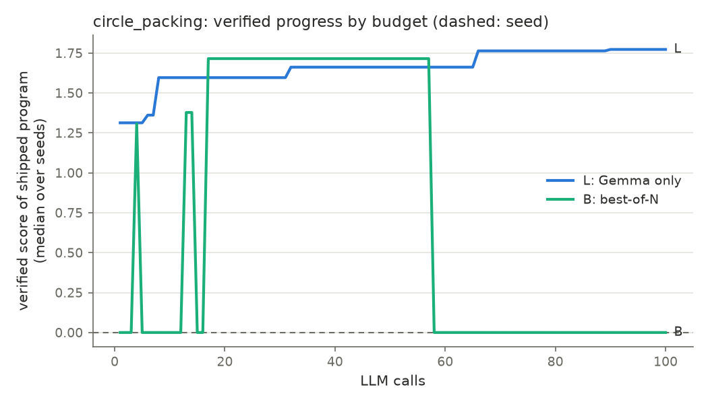
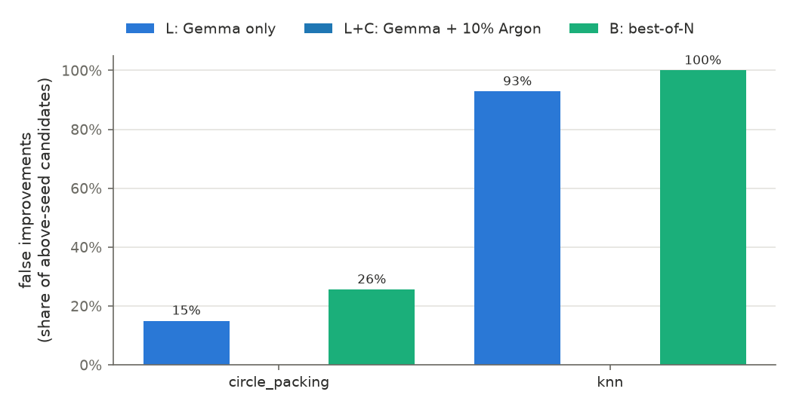
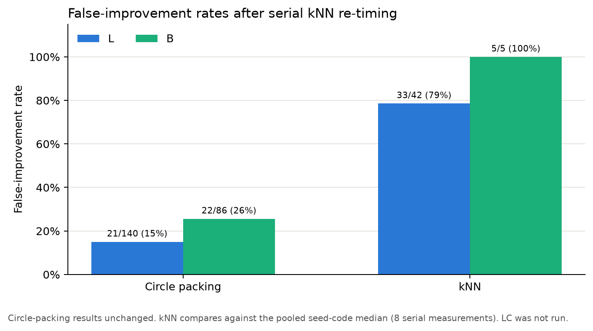

# OpenEvolve pilot: evolution beat best-of-N on circle packing; neither arm improved kNN

**Snapshot:** 2026-11-19 (Europe/Kyiv)
**Study:** laptop OpenEvolve pilot, `gemma4:12b` (`4eb23ef187e2`), pre-registered at tag `oe-pilot-prereg` ([PREREGISTRATION.md](openevolve_pilot/PREREGISTRATION.md))
**Status:** closed. 12 of 18 planned runs complete (arms L and B, both tasks, seeds 101/202/303). Arm LC was closed by the owner after Argon quota exhaustion and is not reported.

## Summary

- **RQ1 (L vs B), circle packing.** Evolution shipped a valid packing in all three runs (median sum of radii 1.773, range 1.596–2.120). Best-of-N shipped an invalid program in two of three runs, so its primary endpoint fell back to the seed's verified score of 0 (median 0, range 0–1.793). This matches the stated expectation L > B.
- **RQ1, kNN.** Neither arm shipped anything better than the seed. In all six runs the program with the highest working score failed the independent re-check, so every run scored its seed. The expectation L > B was not met. Both arms tied at "no improvement".
- **RQ3 (false improvements).** Among candidates the working evaluator ranked above the seed, 15% (L) and 26% (B) were false on circle packing, and 79% (L) and 100% (B) on kNN (serial re-timing, see deviation 6). The expectation "more often on kNN" holds. Five of six runs in arm B and three of six in arm L shipped a false program.
- **RQ2 (LC vs L)** is not answered by this pilot. The Colab study's paired MoE comparison covers the same question with a different model ([LC_RESULTS_2026-11-08.md](colab_scale/LC_RESULTS_2026-11-08.md)).
- With three seeds per arm, the pre-registered pilot analysis is descriptive and specifies no significance test; a post-hoc exploratory check is reported below.

## Runs and deviations

| task | arm | seeds complete | status |
|---|---|---|---|
| circle packing | L, B | 101, 202, 303 | complete, 100 logged calls each |
| kNN | L, B | 101, 202, 303 | complete, 100 logged calls each |
| circle packing | LC | — | `s101` stopped at 8 Gemma calls / 0 Argon calls (quota); kept on disk, excluded |
| kNN | LC | — | not started |

All deviations are logged in [DEVIATIONS.md](openevolve_pilot/DEVIATIONS.md). The ones that bear on interpretation:

1. **Pauses.** The owner paused and resumed the laptop campaign seven times between 2026-10-30 and 2026-11-10. Every pause stopped the worker between calls, and every resume continued from the logged call index with `--resume`. No run was restarted from scratch, and the best-of-N state was consistent (evaluated + failed = calls) at every pause.
2. **LC closed.** The first Argon call of `circle_packing_LC_s101` hit the quota on 2026-11-10 23:10. On 2026-11-11 the owner closed all Argon work, so the six LC runs are not run. Gemma was never substituted for Argon.
3. **Analysis scope.** The pre-registered analysis (`python -m experiments.openevolve.analyze`) aggregates every run folder. It was run on a folder of links to the 12 complete runs, so the partial LC run does not enter the LC arm. The analysis code is unchanged since the registration tag.
4. **Circle-packing score scale.** The pre-registration text defines the verified circle-packing score as the sum of radii divided by 2.635. The re-check code at the registration tag returns the raw sum of radii. Raw sums are reported below, with the ratio to 2.635 in brackets where useful. Working scores are the evaluator's `combined_score`, which is already that ratio.
5. **kNN timing noise.** The kNN holdout score includes a speed penalty that depends on wall-clock time. The pilot's re-checks ran in four to eight parallel Docker workers (each limited to two CPUs on a 32-core host), at different times and under different background load. The same seed program therefore scored between 0.134 and 0.194 across runs. Compare kNN scores within a run, not across runs or arms.
6. **kNN serial re-timing** (2026-11-19, shared with the Colab study). Because of deviation 5, the seed and every valid above-seed kNN candidate were re-checked one sandbox at a time, with three repetitions for programs near the seed score. The same seed code hash has eight serial measurements: five designated calibration repetitions (median 0.238, range 0.192–0.244) and three more when that exact code was selected as a shipped program (median across all eight 0.2235, range 0.161–0.244). The main tables use the median across all observations for each code hash. As a sensitivity check using only the five designated seed measurements, the pilot L-arm false-improvement count is 36/42 (86%), versus 33/42 (79%) with all eight observations; Colab's LC kNN count remains 60/213 and the paired LC-vs-L direction remains 8/9. The registered analysis output and Figure 2 retain the earlier parallel timings. Details: [colab_scale/DEVIATIONS.md](colab_scale/DEVIATIONS.md) and [COLAB_SCALE_RESULTS.md](COLAB_SCALE_RESULTS.md).

The independent re-checks used the registered sandbox image (`sha256:aae97353…7ae2`) and the re-check code at the registration tag.

## RQ1: primary endpoint (shipped verified score)

The primary endpoint is the re-check score of the candidate with the highest working score. If that candidate fails the re-check, the run scores the seed's verified score. The circle-packing seed is itself invalid under the re-check because two circles have radius 0, so its verified score is 0.

| task | arm | s101 | s202 | s303 | median [range] |
|---|---|---:|---:|---:|---:|
| circle packing | L | 2.120 | 1.596 | 1.773 | **1.773** [1.596, 2.120] (ratio 0.673) |
| circle packing | B | 1.793 | 0 † | 0 † | **0** [0, 1.793] |
| kNN | L | 0.223 † | 0.223 † | 0.223 † | 0.223 (= seed in every run) |
| kNN | B | 0.223 † | 0.223 † | 0.223 † | 0.223 (= seed in every run) |

† shipped program failed the re-check; the run scores its seed.

kNN values are the seed's serially timed score (deviation 6); with parallel timing the same seed had scored 0.134–0.194 depending on the run.

*Figure 1. Circle packing: verified score of the program the working evaluator would ship after each call, median over three seeds. Best-of-N reaches 1.72 by call 17 but drops back to 0 at call 58, when a higher-working but invalid candidate takes over. The kNN curves are flat at the seed and are in [fig_curves_knn.png](openevolve_pilot/fig_curves_knn.png).*

## RQ3: false improvements

A false improvement is a candidate that the working evaluator ranks above the seed but that fails the re-check or does not beat the seed's verified score.

| task | arm | false / above-seed evaluations | pooled rate | median per-run rate | runs shipping a false program |
|---|---|---:|---:|---:|---:|
| circle packing | L | 21 / 140 | 15.0% | 7.9% | 0 / 3 |
| circle packing | B | 22 / 86 | 25.6% | 23.1% | 2 / 3 |
| kNN | L | 33 / 42 | 78.6% | 95.5% | 3 / 3 |
| kNN | B | 5 / 5 | 100% | 100% | 3 / 3 |

*Figure 2. Original registered analysis output, preserved as a record of the parallel timing pass. The kNN L bar (93%) is superseded by the serially re-timed value in the table above. The legend entry "L+C" has no bars because arm LC was not run.*

*Figure 3. Circle-packing rates are unchanged. kNN rates use the serial re-timing and the pooled eight-measurement seed score; labels show the number of false candidate evaluations over above-seed evaluations. Arm LC was not run.*

**Why candidates failed.**

- **Circle packing.** Most false candidates contain a circle of radius exactly 0. The working evaluator, which is OpenEvolve's upstream evaluator, accepts such a circle; the re-check requires radii > 0. A few candidates produced different packings on two identical runs.
- **kNN.** All six shipped programs return the correct neighbours (holdout recall 0.98–1.00) and run faster than exact search (time ratio 0.68–0.79). They fail because they cast the data to float32, and the distances they return then differ from the true squared distances by more than the re-check's tolerance (relative 1e-7). The task statement in the seed program requires "the true squared distances of the returned indices". The working evaluator does not check distances, so it rewards the precision shortcut, and part of the speed gain comes from it.

## Secondary endpoints

| task | arm | best verified, median [range] | Gemma wall time (3 runs) | truncated replies | best-of-N replies not applicable |
|---|---|---:|---:|---:|---:|
| circle packing | L | 1.773 [1.596, 2.120] | 7.7 h | 13 / 300 | — |
| circle packing | B | 1.715 [1.490, 1.793] | 5.8 h | 9 / 300 | 143 / 300 |
| kNN | L | not reported after serial re-timing | 9.2 h | 78 / 300 | — |
| kNN | B | not reported after serial re-timing | 9.8 h | 245 / 300 | 243 / 300 |

- **Selection lost what search found.** In circle packing B the best valid candidates (1.49–1.79) were found in every run, but the working evaluator ranked an invalid one higher in two runs. In kNN L, nine valid candidates in two runs were in fact slightly faster than the seed under serial timing (up to 0.25 against 0.22), but the working evaluator ranked an invalid float32 program higher, so none was shipped.
- **kNN secondary endpoint.** The old best-verified values used parallel timing and are not retained. The serial pass covered the shipped programs and all above-working-seed candidates, not every candidate needed to recompute the registered best-verified endpoint. Among L's 42 above-seed candidate evaluations, nine valid candidates across two runs scored above the pooled seed score; none was selected for shipment.
- **Output budget.** On kNN, 82% of best-of-N replies (245/300) and 26% of evolution replies reached the 2048-token output limit, so most best-of-N attempts produced no usable diff. Why best-of-N truncates so much more often was not analysed.
- **Inapplicable diffs.** About half of the circle-packing best-of-N replies (143/300) did not apply to the seed. The commonest cause is a SEARCH block that misquotes one comment line of the seed; the same 12B misquote is analysed for the Colab study in [colab_scale/DEVIATIONS.md](colab_scale/DEVIATIONS.md) (2026-11-02 and 2026-11-13 entries).
- **Median call latency** was 62–66 s for circle-packing B, 86–95 s for L, and 97–128 s for kNN.

## Reading these results

- On circle packing, evolution improved on the seed more reliably than independent sampling at the same budget, mainly because best-of-N shipped invalid programs. Its best candidates were not far below evolution's.
- On kNN, the working evaluator was unreliable enough that no run of either arm shipped a genuine improvement. The working evaluator's main gap, unchecked distances, is the one the candidates exploited.
- A follow-up study should use the variance seen here to choose the seed count. It should also check distances in the kNN working evaluator and raise the output budget for best-of-N.

## Exploratory statistics (not pre-registered)

With three seeds per arm, no comparison in this pilot can reach conventional significance. L vs B on circle packing gives a Mann–Whitney p of 0.38 (medians 1.77 vs 0). On kNN, both arms ship the seed in every run. The joint exploratory analysis of both studies is in [COLAB_SCALE_RESULTS.md](COLAB_SCALE_RESULTS.md#exploratory-statistics-not-pre-registered).

## Data

- Per-run re-check summaries: `benchmarks/openevolve_pilot/<run>/summary.json` (not tracked; backed up under `~/Backups/cloudedge`).
- Aggregate output of the pre-registered analysis: [openevolve_pilot/summary_2026-11-19.json](openevolve_pilot/summary_2026-11-19.json).
- Per-candidate re-check results: `benchmarks/openevolve_pilot/<run>/rechecked.jsonl`.
