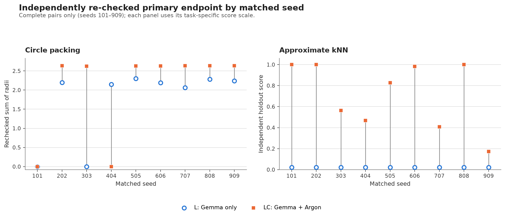

# LC had higher primary scores on all nine kNN pairs; circle-packing results were mixed

**Snapshot:** 2026-11-08 (Europe/Kyiv)
**Study:** Gemma 4 26B OpenEvolve runs, Gemma-only arm `L` versus cloud-assisted arm `LC`
**Status:** stopped after Argon quota exhaustion; no further Argon calls are planned.

## Summary

- Eighteen of the first 20 planned LC runs completed; two seed-1010 runs paused at quota. Across the 18 complete matched pairs, LC had a higher primary endpoint in 16, tied in one and was lower in one.
- The task-level pattern differs: LC was higher in all nine kNN pairs, while circle packing was higher in seven, tied in one and lower in one. Four of 36 paired working-best programs failed independent validation; all four were circle-packing programs.
- These results are descriptive for two task families. The 30-run amendment remains incomplete; the above-seed false-improvement analysis covers only the 36 complete matched runs, not the six unpaired controls.

## Status and cohort accounting

The 2026-11-07 amendment planned 30 `LC` runs total. After the Argon quota reached zero, the owner chose to stop at the first 20 `LC` slots, which were considered sufficient. This is a stopping deviation from the 30-run amendment; it does not change the original pre-registration or make the partial runs complete.

| Cohort | Seeds per task | Planned LC | Complete LC | Paused LC | Not started |
|---|---|---:|---:|---:|---:|
| Original pre-registered cohort | 101–505 | 10 | 10 | 0 | 0 |
| Extension with existing L controls | 606–1010 | 10 | 8 | 2 | 0 |
| New-control extension | 1111–1515 | 10 | 0 | 0 | 10 |
| **Total** | | **30** | **18** | **2** | **10** |

The two paused runs are `circle_packing_LC_s1010` (48/100 calls) and `knn_LC_s1010` (12/100 calls). Neither is used as a completed outcome. All ten originally pre-registered `LC` runs completed. In the next cohort, seeds 606, 707, 808 and 909 completed for both tasks; seed 1010 did not.

There are **18 complete matched L/LC pairs**, nine per task, over seeds 101–909. The six completed L controls for seeds 1111, 1212 and 1313 are unpaired because their LC partners never started. They are retained below and in the run-level data file; they are excluded from paired comparisons. The L controls for seeds 101–1010 are complete, including both seed-1010 controls.

## Endpoint and verification method

The primary endpoint follows the registered rule: select the candidate with the highest working `combined_score` (first candidate on ties); if it passes the independent re-check, use its re-check score, otherwise fall back to the seed program's re-check score. A failed seed has score zero.

The independent re-check examined the seed and selected working-best candidate for each of the 44 complete L/LC runs (26 L and 18 LC). It also re-checked every above-seed candidate evaluation in the 36 complete matched runs: **1,100 evaluation rows and 1,093 unique code hashes**. Across these checks, 1,098 unique programs were independently evaluated; duplicate hashes were cached. Repeated candidate evaluations still count separately in the registered candidate-level denominator. The six unpaired L controls were checked only at seed and working-best level. Candidates below seed were not re-checked, so an all-candidate best-verified score and verified progress curves are not reported.

- **Circle packing:** raw independently checked sum of radii for 26 circles. The check requires positive finite radii, containment, pairwise non-overlap at tolerance `1e-12`, deterministic output across two sandbox executions, and the registered static restrictions. Values are raw sums of radii, not normalized scores.
- **kNN:** the registered score on three holdout sets, after six fresh randomized validity challenges, exact-copy checks and static restrictions. The score is in `[0, 1]`.
- Candidate execution used the local Docker image registered for the study, `antigravity-orion:local`, image digest `sha256:aae973535ab734c026d878c0ef1d7ec1164b83538bdcd63c192476672cb27ae2`.

The task-specific scores have different meanings and scales. Results are therefore summarized by task, with only the direction of paired differences described across tasks. The pre-registration specified descriptive reporting, not a significance test; none is added here.

## Paired primary-endpoint results

Each cell reports the median and range across complete matched pairs. `Δ` is `LC − L`; the last column counts pairs where LC was better, equal or worse. Ranges and medians are descriptive and rounded for display.

| Cohort | Task | Pairs | L median [range] | LC median [range] | Δ median [range] | Better / equal / worse |
|---|---|---:|---:|---:|---:|---:|
| Original, seeds 101–505 | Circle packing | 5 | 2.1481 [0, 2.2988] | 2.6263 [0, 2.6343] | 0.3281 [−2.1481, 2.6263] | 3 / 1 / 1 |
| Original, seeds 101–505 | kNN | 5 | 0.02243 [0.02243, 0.02243] | 0.82636 [0.46758, 1.00000] | 0.80393 [0.44515, 0.97757] | 5 / 0 / 0 |
| Existing-control extension, completed seeds 606–909 | Circle packing | 4 | 2.2153 [2.0621, 2.2823] | 2.6343 [2.6295, 2.6360] | 0.4175 [0.3520, 0.5722] | 4 / 0 / 0 |
| Existing-control extension, completed seeds 606–909 | kNN | 4 | 0.02243 [0.02243, 0.02243] | 0.69462 [0.17339, 1.00000] | 0.67219 [0.15097, 0.97757] | 4 / 0 / 0 |
| All available pairs, seeds 101–909 | Circle packing | 9 | 2.1918 [0, 2.2988] | 2.6295 [0, 2.6360] | 0.3973 [−2.1481, 2.6263] | 7 / 1 / 1 |
| All available pairs, seeds 101–909 | kNN | 9 | 0.02243 [0.02243, 0.02243] | 0.82636 [0.17339, 1.00000] | 0.80393 [0.15097, 0.97757] | 9 / 0 / 0 |

*Figure 1. Each vertical connector joins the L and LC outcome for one seed. The circle-packing panel uses raw sums of radii; the kNN panel uses its 0–1 holdout score. Invalid selected candidates use the registered seed-score fallback.*

Across the 18 available pairs, the LC primary endpoint was higher in 16, equal in one and lower in one. By task, the observed direction was 9/9 higher for kNN and 7/9 higher, 1/9 equal and 1/9 lower for circle packing. This is a descriptive result on two task families and nine matched seeds per task; it is not evidence of generalization or statistical equivalence.

The selected candidate passed its independent check in **16/18 runs in each arm**. All four selected-candidate failures in the paired data were circle-packing runs. The original cohort had 8/10 selected candidates pass in each arm; the eight completed pairs in the next cohort had 8/8 pass in each arm. For two LC circle-packing runs the working-best candidate failed the stricter independent check: seed 101 had tiny overlaps above the `1e-12` tolerance, and seed 404 also had overlaps; the seed-404 L comparison candidate passed. The L circle-packing candidate for seed 303 failed the deterministic-output check. Invalid selected candidates fell back to the seed score, which was zero for circle packing because the seed program contains two zero-radius circles.

## False improvements among above-seed candidates

A false improvement is a candidate evaluation whose working `combined_score` exceeds that run’s seed score but whose independent re-check is invalid or does not exceed the seed’s verified score. Repeated evaluations of the same code count again in the denominator, as in the registered pooled metric. The table reports the pooled candidate rate and the median of per-run rates; runs with no above-seed candidates contribute 0 to the median. “Selected false” counts working-best candidates that are themselves false improvements.

| Cohort | Task | Arm | False / above-seed evaluations | Pooled rate | Median run rate | Selected false runs |
|---|---|---|---:|---:|---:|---:|
| Original, 101–505 | Circle packing | L | 82 / 235 | 34.9% | 37.1% | 2 / 5 |
| Original, 101–505 | Circle packing | LC | 68 / 241 | 28.2% | 30.9% | 2 / 5 |
| Original, 101–505 | kNN | L | 1 / 1 | 100.0% | 0.0% | 1 / 5 |
| Original, 101–505 | kNN | LC | 3 / 102 | 2.9% | 0.0% | 0 / 5 |
| Existing controls, 606–909 | Circle packing | L | 36 / 165 | 21.8% | 17.9% | 0 / 4 |
| Existing controls, 606–909 | Circle packing | LC | 72 / 245 | 29.4% | 27.3% | 0 / 4 |
| Existing controls, 606–909 | kNN | L | 0 / 0 | — | 0.0% | 0 / 4 |
| Existing controls, 606–909 | kNN | LC | 1 / 111 | 0.9% | 0.0% | 0 / 4 |
| All available pairs, 101–909 | Circle packing | L | 118 / 400 | 29.5% | 28.6% | 2 / 9 |
| All available pairs, 101–909 | Circle packing | LC | 140 / 486 | 28.8% | 30.0% | 2 / 9 |
| All available pairs, 101–909 | kNN | L | 1 / 1 | 100.0% | 0.0% | 1 / 9 |
| All available pairs, 101–909 | kNN | LC | 4 / 213 | 1.9% | 0.0% | 0 / 9 |

For circle packing, the pooled LC and L rates are close overall, but the cohort-specific direction changes: LC is lower in the original five-seed cohort and higher in the next four complete pairs. This does not support a stable reduction in false improvements. For kNN, LC has four false candidates among 213 above-seed evaluations. L produced only one above-seed evaluation across nine runs, and it was false; that denominator is too small for a meaningful rate comparison.

Run-level results and candidate-to-recheck mappings are available in [`results/lc_false_improvements_by_run_2026-11-08.csv`](results/lc_false_improvements_by_run_2026-11-08.csv), [`results/lc_false_improvements_by_group_2026-11-08.csv`](results/lc_false_improvements_by_group_2026-11-08.csv), and [`results/lc_above_seed_candidates_2026-11-08.csv`](results/lc_above_seed_candidates_2026-11-08.csv).

## Unpaired L controls

These six complete runs belong to the new-control extension and have no LC partner. They are reported to preserve the available data, not as treatment comparisons.

| Task | Seed | L primary endpoint | Selected candidate passed re-check? |
|---|---:|---:|---|
| Circle packing | 1111 | 2.1665 | Yes |
| Circle packing | 1212 | 2.2402 | Yes |
| Circle packing | 1313 | 0 | No; fell back to the seed score |
| kNN | 1111 | 0.02243 | Yes; selected program is the seed |
| kNN | 1212 | 0.02243 | Yes; selected program is the seed |
| kNN | 1313 | 0.02243 | Yes; selected program is the seed |

## Argon and artifact accounting

- The 18 completed LC runs used **198 Argon calls** and **4,641,254 recorded tokens**.
- The two paused runs add **5 Argon calls** and **100,650 tokens**; both remain partial and excluded from outcomes.
- Across all 20 LC artifacts this is 203 Argon calls and 4,741,904 tokens. Argon calls were selected probabilistically at the registered 0.1 share, so per-run counts need not equal ten.
- The downloaded audit set contains 46 run directories: 26 complete L controls, 18 complete LC runs and 2 paused LC runs. All 46 have the expected task-configuration SHA-256; all 46 have an empty `git_sha` field. The 44 complete runs contain 4,400 logged calls; the two partial LC runs contain 60 more.
- The raw run artifacts remain in `gs://oe-colab-scale-0903767759/runs/gemma4-26b/`. Compact run, pair, candidate, and unique-program re-check records are in [`results/`](results/).

## Limitations and interpretation

1. The 30-run amendment was not completed: ten LC slots were never started and two of the first twenty slots stopped at quota exhaustion. Only 18 matched complete pairs support the comparison.
2. The completion of the first cohorts and quota-based truncation of seed 1010 were operationally determined. No missing outcome is imputed or replaced.
3. All above-seed candidates were re-checked for the 36 complete matched runs, but candidates below the seed were not. The all-candidate best-verified-score endpoint and verified progress curves remain unmeasured; the six unpaired L controls have only seed and working-best checks.
4. Empty `git_sha` fields prevent a run-by-run source-commit link. Config hashes are consistent, and the registered re-check Docker image digest was used, but exact per-run driver provenance cannot be recovered from the manifests alone.
5. These are two task families in one model and one serving setup. The results do not establish performance on real-world repositories or broader software tasks.

**Supported conclusion:** in the completed data, LC was associated with higher selected verified scores on the kNN task for all nine matched seeds and on circle packing for seven of nine. Circle packing also had LC selected candidates that failed the independent validity check. This supports a limited, task-specific observation; it does not justify a general claim that Argon assistance is uniformly better.
